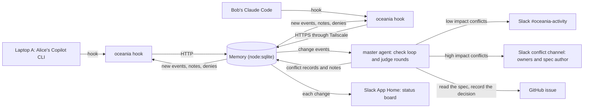

# Oceania

Oceania is a multiplayer mode for the AI coding agents of a team.

Each engineer uses their own agent on their own computer, for example GitHub Copilot CLI or Claude Code. The hooks of each agent read from and write to one shared Memory. A master agent watches the Memory. It finds conflicts between the agents early, and it decides who resolves each conflict:

- **Low impact** (how the code is written): the agents fix the conflict themselves. Oceania tells the agent that must change what to do.
- **High impact** (what the product does, or how to read the spec): the spec author decides in Slack. Oceania pauses the agents until the decision, then resumes them with it.

## Architecture



Oceania has three parts:

1. **`oceania hook`** (`src/adapter.ts`). Each agent hook runs this command. It reads the hook payload, adds local git data (repo, base commit, diff, latest known main), sends both to Oceania, and prints the answer in the format of that agent. It uses only Node built-in modules, so a computer that runs only an agent does not need `npm install`. If Oceania is not available, the command prints nothing and exits with code 0, so the agent continues to work.
2. **Oceania server** (`src/cli.ts serve`). One Node process keeps the Memory in `oceania.db`, receives hook requests on `127.0.0.1:4100`, runs the master agent, connects to Slack in Socket Mode, and uses the `gh` CLI for GitHub.
3. **Master agent** (`src/master.ts`, `src/judge.ts`). Each new task, diff, or push starts one judge round. A judge round uses the Claude Agent SDK with Claude Opus and these tools: `read_memory`, `get_spec`, `track_conflict`, `notify`, `post_activity`, `escalate`, `check_merge`, `run_in_worktree`. Every 60 seconds, the master agent also runs a deterministic check. When a working session has no event for 10 minutes, Oceania adds one `stall` event: `<who> may be stalled.` A new event from that session ends the stall. A `stall` event does not start a judge round, but the next round gets it.

## Conflict lifecycle

Memory keeps one record for each conflict, from discovery to resolution. The stage of a conflict is where its changes are:

| Stage | Where the changes are | How Oceania finds it |
|---|---|---|
| Before: tasks conflict | Only the tasks conflict. | The master agent compares tasks, diffs, the spec, and decisions. |
| During: changes not on main | In the diff of a session. | The live check on each file write, and the master agent. |
| After: changes on main | On main. | Push detection, and the master agent. |

- **Live check.** Before each file write, Oceania checks the path against the diffs of the other sessions in the same repo. If another session changed the file, and this session did not see that diff version, Oceania denies the write and sends the other diff. The session that changed the file first has priority.
- **Push detection.** After each tool call, the hook reports the latest known main of the clone. When main changes and files leave the diff of the session, Oceania records a push. A pull does not remove files from the diff, so a pull is not a push.
- **Merge check.** Oceania keeps a bare clone of the repo in `.oceania/repo` (not in git). It clones `https://<repo>.git` when the first session reports git data. After each tool call, Oceania updates the shadow ref `refs/oceania/<session>` in the background: a commit with the session diff on top of the base commit of the session. The `check_merge` tool runs `git merge-tree --write-tree` on the shadow refs of two sessions and returns the files that conflict. No work tree changes.
- **Test check.** The `run_in_worktree` tool merges the shadow refs of two sessions in the same way. If the merge has no conflicts, Oceania checks out the merged tree in a temporary `git worktree` and runs `npm test` there. Thus the master agent can find a change in one diff that breaks the code in the other diff. The tool returns the test output (at most 9,000 bytes) when the tests fail. Oceania stops the tests after 60 seconds and always removes the temporary worktree. If `package.json` has no `test` script, Oceania does not run tests. Oceania does not run `npm install` in the worktree. The tests run the code of the agents on the Oceania computer, and they do not get the Slack and Anthropic secrets from `.env`.
- **Each round,** the master agent checks each open conflict again. It updates the stage and the impact, takes the next action, or marks the conflict resolved. A decision stays open until main has it.
- **History.** Memory keeps the history of each conflict: one step for the start and for each change of stage, impact, or status. The status board shows it as one line, for example `Before 9:03 PM → During 9:04 PM → After 9:05 PM → Resolved 9:06 PM`. The Oceania feed prints one line for each change.

## Requirements

- Node 26 (Oceania runs the TypeScript files directly).
- `gh`, signed in to GitHub.
- Git 2.38 or later, for `git merge-tree --write-tree`. Git on the Oceania computer must be able to clone the repo over HTTPS. For a private repo, run `gh auth setup-git`.
- A Slack workspace with the Oceania app. Create the app from `slack-manifest.json`, install it, and create an app-level token with the `connections:write` scope.
- An Anthropic API key for the master agent only. Do not set `ANTHROPIC_API_KEY` in the shell that runs Claude Code.
- Tailscale, if an agent runs on a different computer.

## Set up and run

```bash
npm install
npm test          # unit tests; the judge smoke test runs only with ANTHROPIC_API_KEY
npm run check     # tsc --noEmit
npm start         # node --env-file=.env src/cli.ts serve
```

`.env` (not in git):

```text
ANTHROPIC_API_KEY=...
SLACK_BOT_TOKEN=xoxb-...
SLACK_APP_TOKEN=xapp-...
OCEANIA_REPO=<owner>/<repo with the spec issues>
```

`members.json` (not in git). `email` is the Slack email of the member. `github` connects a spec author to their GitHub account.

```json
[
  { "name": "Tverous", "email": "tverous@example.com", "github": "Tverous" },
  { "name": "Alice", "email": "alice@example.com" },
  { "name": "Bob", "email": "bob@example.com" }
]
```

**Oceania feed.** `npm start` prints one short line for each message that goes through Oceania: the events of the agents (join, task, change, push), each text that Oceania sends to an agent (team status, the tasks and pushes of the other agents, block, pause, note, resume), each change of a conflict lifecycle (for example `Conflict #2 · Before → During · low impact`), the Slack questions, the decisions, and one line for each judge round. The colors show the stage of a conflict. Set `NO_COLOR=1` to stop the colors. The full texts go to `oceania.log` in the working directory: the judge results and tool calls, the Slack logs, the errors, and each complete text that an agent got. `oceania.log` is not in git. `scripts/reset-demo.sh` removes it.

## Hook settings

Each clone has its own hook file. Add the file path to `.git/info/exclude` of that clone. `OCEANIA_MEMBER` is the email of the owner. Use the absolute path of `node` (`command -v node`).

**Copilot CLI**: `<clone>/.github/hooks/oceania.json`. Use PascalCase event names. Copilot loads repo hooks only from a trusted folder, so add the clone to `trustedFolders` in `~/.copilot/config.json`.

```json
{
  "version": 1,
  "hooks": {
    "SessionStart":     [{ "type": "command", "bash": "<command> --agent copilot", "timeoutSec": 30 }],
    "UserPromptSubmit": [{ "type": "command", "bash": "<command> --agent copilot", "timeoutSec": 30 }],
    "PreToolUse":       [{ "type": "command", "bash": "<command> --agent copilot", "timeoutSec": 30 }],
    "PostToolUse":      [{ "type": "command", "bash": "<command> --agent copilot", "timeoutSec": 30 }],
    "Stop":             [{ "type": "command", "bash": "<command> --agent copilot", "timeoutSec": 600 }]
  }
}
```

**Claude Code**: `<clone>/.claude/settings.local.json`.

```json
{
  "hooks": {
    "SessionStart":     [{ "hooks": [{ "type": "command", "command": "<command> --agent claude" }] }],
    "UserPromptSubmit": [{ "hooks": [{ "type": "command", "command": "<command> --agent claude" }] }],
    "PreToolUse":       [{ "matcher": "*", "hooks": [{ "type": "command", "command": "<command> --agent claude" }] }],
    "PostToolUse":      [{ "matcher": "*", "hooks": [{ "type": "command", "command": "<command> --agent claude" }] }],
    "Stop":             [{ "hooks": [{ "type": "command", "command": "<command> --agent claude", "timeout": 600 }] }]
  }
}
```

`<command>` is:

```text
OCEANIA_MEMBER=<email> OCEANIA_URL=<Oceania URL> /absolute/path/to/node /absolute/path/to/oceania/src/cli.ts hook
```

`OCEANIA_URL` is `http://127.0.0.1:4100` (the default) on the computer that runs Oceania.

The `Stop` timeout is 600 seconds. A paused agent waits in its `Stop` hook for the decision: up to 90 seconds for the running judge round, then up to 480 seconds for the decision.

## Agents on other computers

The Oceania server listens only on `127.0.0.1`, because the MVP has no authentication. To let an agent on another computer connect, the computer that runs Oceania shares the port in its tailnet:

```bash
tailscale serve --bg 4100
```

The other computer sets `OCEANIA_URL` to the tailnet HTTPS URL, for example `https://laptop-a.example.ts.net`. Only devices in the tailnet (or devices that you share the machine with) can connect. The other computer needs only Node, its agent, and a clone of this repo for `oceania hook`.

## Demo

The demo repo has `src/plans.ts` (the plans), `src/pricing.ts` (writes `pricing.html`), and `AGENTS.md` (pull first, commit and push when done, rebase before push). Issue #1 says: "Launch a Pro plan with a free trial. Add the plan and show it on the pricing page." It does not say the trial length or if a card is necessary.

Alice uses Copilot CLI and Bob uses Claude Code. Each engineer keeps one agent session and sends one task in each round. Bob's agent runs on laptop B. The spec author operates it from laptop A with `ssh` over the tailnet, so the screen of laptop A shows both agents and the Oceania feed.

1. **Round 1, different requirements.** Alice: `Add a yearly price to each plan in src/plans.ts. The yearly price is 10 times the monthly price.` About 10 seconds later, Bob: `Add a short FAQ section below the plan table on the pricing page.` Each agent gets the task and the push of the other agent from Oceania. The files are different, so there is no conflict. The second agent to push rebases first.
2. **Round 2, the same spec read two ways.** Alice: `Add the Pro plan from #1 to src/plans.ts: 14-day trial, card required.` Bob: `Show the Pro plan from #1 on the pricing page. Use a 30-day free trial with no card.`
   - **Conflict A (before, high impact).** The trial terms disagree, and the spec does not say them. Oceania opens a Slack conflict channel with the question and the options, and pauses both agents.
   - **Conflict B (before, low impact).** Bob's page needs the Pro plan that Alice adds. A note tells Bob's agent to use her plan data.
   - The spec author clicks "30 days, no card". Oceania records the decision on issue #1 and resumes both agents with it. Conflict A becomes resolved only after a push shows that main has the decision.
3. **Round 3, the same file at the same time.** Alice: `Show the yearly price next to the monthly price on the pricing page.` Bob: `Mark the Pro plan as Most popular on the pricing page.` Both change `src/pricing.ts`. The live check denies Bob's write and sends Alice's diff (during). After one agent pushes, the other agent is told to pull with rebase (after). All conflicts become resolved.
4. The App Home board shows both agents and the lifecycle of each conflict. `node src/pricing.ts` on main shows the Pro plan (30-day free trial, no card, Most popular) with monthly and yearly prices and the FAQ.

`scripts/reset-demo.sh` resets the demo clones, the Memory, and the decision comments.

## Limitations

- No authentication. Oceania listens only on `127.0.0.1`. Use `tailscale serve` to reach it from other devices in your tailnet.
- Oceania cannot wake an idle agent. An idle agent gets its updates at its next tool call.
- Only agents with hooks are supported (Copilot CLI and Claude Code).
