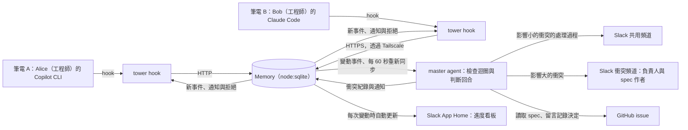

# Tower：讓任何人的 AI agent 隨時隨地協作

- **日期：** 2026-11-10
- **狀態：** 草稿。參賽團隊審閱中。
- **活動：** c0mpiled-18，YC Startup School Hackathon（台北），2026-11-11
- **題目：** YC Request for Startups 的「Multiplayer AI」
- **名稱：** Tower。這個名稱取自機場塔台。每位機長駕駛自己的飛機。塔台看得到所有飛機，提前預警碰撞，只在必要時聯絡機長。

## 術語

本文件中的每個術語只有一個意思。

| 術語 | 意思 |
|---|---|
| 參賽團隊 | 參加這次 hackathon 的三個人與實作者。 |
| 實作者 | 負責實作 Tower 的 AI，也就是 Copilot CLI 上的 Claude Opus 5.5。 |
| 成員 | 使用 Tower 的產品團隊中的一個人。MVP 的成員是工程師。之後的版本也支援 PM、業務、客服與行銷。 |
| agent | 成員自己使用的 AI agent。參賽團隊的架構圖稱它為 subagent。MVP 支援 Copilot CLI 與 Claude Code。兩者都透過 hook 連接 Tower。 |
| session | 一個 agent 從啟動到結束的一次執行。 |
| 負責人 | 啟動某個 session 的成員。 |
| 任務 | 負責人交給 agent 的一項工作。agent 收到 prompt 時，Tower 把 prompt 記錄成任務。 |
| spec | 成員撰寫的需求說明。spec 放在 GitHub issue。 |
| spec 作者 | 撰寫 spec issue 的成員。 |
| main | demo repo 在 GitHub 上的預設分支。main 是所有成員共用的程式碼。 |
| diff | working tree 相對於基準 commit 的變更。基準 commit 是 `HEAD` 與 origin 預設分支的 merge base。因此 diff 包含還沒推送的 commit，也包含未追蹤的檔案。 |
| 推送 | agent 把 commit 推送到 main。推送後，這些變更離開這個 session 的 diff，進入 main。 |
| Memory | Tower 伺服器中持久保存的共享狀態。所有 agent 與 master agent 都透過 Memory 交換資訊。 |
| Tower 伺服器 | 保存 Memory 並執行 master agent 的單一 Node process。 |
| 筆電 A | Tverous 的筆電。筆電 A 執行 Tower 伺服器與 Alice 的 agent。 |
| 筆電 B | 參賽團隊另一個人的筆電。筆電 B 執行 Bob 的 agent，並透過 Tailscale 連到筆電 A 上的 Tower 伺服器。 |
| adapter | `tower hook` 指令。agent 的每個 hook 都執行 `tower hook`。 |
| master agent | 協調所有 agent 的 agent。master agent 持續執行檢查迴圈。 |
| 檢查迴圈 | master agent 持續執行的檢查。每一輪都重新評估所有未解決的衝突。 |
| 判斷回合 | master agent 用 Claude Agent SDK 與 Claude Opus 執行的一次 agent run。判斷回合可以呼叫工具。 |
| 進度看板 | Tower 在 Slack App Home 的 Home 分頁顯示的看板。Memory 每次變動時，進度看板自動更新。 |
| 確定性檢查 | 不呼叫模型的檢查。相同的輸入一定產生相同的結果。 |
| 衝突 | 兩個以上的 session 的任務或變更互相矛盾、互相重複，或會互相破壞。Memory 用一筆衝突紀錄追蹤一個衝突，從發現到解決。 |
| 階段 | 衝突的變更目前所在的位置。階段有三個：發生前、發生中與發生後。 |
| 發生前 | 只有任務互相衝突。衝突的變更還不存在。 |
| 發生中 | 衝突的變更已經在某個 session 的 diff 中，但還沒推送到 main。 |
| 發生後 | 衝突的變更已經推送到 main。 |
| 影響 | 衝突對產品的影響。影響決定由誰解決衝突。影響有兩個等級：小與大。 |
| 影響小 | 衝突只影響程式碼的寫法，不改變產品行為。例如重複工作、修改同一個檔案、合併衝突或介面破壞。agent 自行解決這類衝突。參賽團隊架構圖中的「程式碼衝突」屬於這一類。 |
| 影響大 | 衝突改變產品行為或 spec 的解讀，或需要丟棄已推送的工作。例如雙方對 spec 的解讀互相矛盾。spec 作者決定這類衝突。參賽團隊架構圖中的「scope conflicts」屬於這一類。 |
| 偏離 | session 的任務或 diff 與 spec 或已記錄的決定不符。master agent 把偏離當成這個 session 與 spec 之間的衝突。 |
| 待決事項 | 影響大的衝突中，需要 spec 作者從選項中決定的一件事。 |
| 通知 | master agent 寫入 Memory、要送給特定 session 的訊息。 |
| 事件 | Memory 每次變動的紀錄。master agent 與所有 session 都讀取事件。 |
| 讀取位置 | 某個 session 已讀取的最後一個事件。 |
| 共用頻道 | Slack 上的一個頻道。master agent 在這裡貼出影響小的衝突的處理過程。 |
| 衝突頻道 | Tower 伺服器為一個影響大的衝突建立的 Slack 頻道。 |
| 暫停 | Tower 伺服器拒絕某個 session 的所有工具呼叫，直到 spec 作者決定。 |
| 恢復 | Tower 伺服器讓暫停的 session 帶著決定開始新的一輪。 |
| 決定 | spec 作者在衝突頻道點選的選項。 |

## 1. 為什麼要做

產品團隊中的每位成員都在使用自己的 agent。這些 agent 彼此不交換資訊。成員只能自己補上這個缺口。成員把 agent 的輸出貼到聊天室，再開會同步。

成員到 merge 或上線之後，才發現衝突。那時重複或矛盾的工作已經完成。

以下證據顯示這個問題真實存在，而且代價高。

- **同時修改的檔案更容易引入 bug。**
  - Microsoft 的 ConE 研究（ACM TOSEM，2022）發現：在不同 pull request 中同時修改的檔案，更容易引入 bug。
  - Microsoft 在內部 234 個 repo 部署 ConE。ConE 針對同時修改提出 775 次提醒。
  - 開發者把超過 70% 的提醒評為有用。在 48 位受訪使用者中，超過 90% 想繼續使用 ConE。
  - 這項研究發表時，開發者還沒有普遍同時使用多個 agent。
- **現有的 agent 協作工具只支援單一成員。**
  - Claude Code agent teams 協調同一位成員的多個 session。agent teams 的 mailbox 是 `~/.claude/teams/` 底下的本機檔案。
  - MCP Agent Mail 提供 agent 收件匣與「自願」的檔案預約。只有選用的 pre-commit guard 會強制執行檔案預約。
  - Orca 協調同一位成員的多個 worker。Orca 的 CLI 沒有「多位成員」的概念。
  - 這三個工具都不協調屬於不同成員的 agent。

**Tower 讓 agent 的工作變成多人協作。** 每位成員繼續使用自己的 agent。所有 agent 都把工作狀態寫入同一個 Memory，也持續從 Memory 讀取其他 agent 的狀態。master agent 持續檢查 Memory，並追蹤每個衝突的完整生命週期。master agent 在發生前預測衝突，在發生中阻止衝突，在發生後修正衝突。影響小的衝突由 agent 自行解決。只有影響大的衝突，Tower 才請成員決定。

**越早發現，代價越小。** Crystal 研究（Brun 等人，FSE 2011）分析了 9 個開源系統、共 55 萬個開發版本。研究發現：衝突很常見，而且會持續存在。衝突不只是重疊的文字修改，也會在之後造成 build 與測試失敗。Crystal 幫助開發者及早發現並解決衝突。及早的意思是衝突變嚴重之前，也是開發者忘記相關修改之前。

**最終目標：** 任何成員的 agent，都能在任何時間、任何地點協作。成員不必同時在線，也不必在同一個地方。

**隨時掌握進度：** 成員隨時打開 Slack 中 Tower 的進度看板，就能看到大家做到哪裡。進度看板自動更新。成員不必詢問，也不必開會同步進度。

## 2. 目標

1. **任何人、任何時間、任何地點。** 任何成員的 agent 都能隨時加入協作。
   - agent 透過網路連到 Tower 伺服器。
   - Memory 持久保存。成員與 agent 不必同時在線。
   - Memory 保存通知與決定，直到 agent 下一次讀取時送達。
2. **成員使用 agent 的方式不變。** agent 透過 hook 自動讀寫 Memory，並接受暫停。成員不需要改變自己的工作方式。
3. **每個 agent 持續讀寫 Memory。** agent 的每次工具呼叫都會讀寫 Memory（第 7.2 節）。
4. **追蹤每個衝突的完整生命週期。** master agent 持續執行檢查迴圈。每一輪都重新評估所有未解決的衝突（第 7.4 節）。
   - 發生前：從任務預測衝突。
   - 發生中：在衝突的變更推送到 main 之前阻止衝突。
   - 發生後：在衝突的變更推送到 main 之後修正衝突。
5. **依照影響決定由誰解決。** master agent 評估每個衝突的影響。
   - 影響小：master agent 通知相關的 session，並把處理過程貼到共用頻道。成員可以查看共用頻道，但 Tower 不會 @ 成員。
   - 影響大：spec 作者決定（第 7.6 節）。
6. **成員不必詢問就能掌握進度。** 進度看板顯示每位成員的 agent 正在做什麼，以及每個衝突的階段。Memory 每次變動時，Tower 伺服器自動更新進度看板。
7. **完整展示流程。** 參賽團隊用一支 2 分鐘以內的影片展示整個流程。

## 3. Hackathon MVP 不做的事

- 支援工程師以外的成員，例如 PM、業務與客服。之後的版本用 MCP server 連接沒有 hook 的 agent，例如 Claude Desktop。MCP 工具只在模型決定時執行，因此 MVP 只使用 hook。
- 網頁看板。Slack App Home 的進度看板取代網頁看板。
- 在進度看板上指揮 agent。MVP 的進度看板只顯示 Memory。
- 向 master agent 詢問的聊天介面。進度看板讓成員不必詢問。
- 喚醒閒置的 agent。Claude Code 文件記載 `asyncRewake` hook 可以喚醒 Claude。實作者沒有在 Copilot CLI 文件中找到對應的功能。
- 驗證 Copilot CLI 與 Claude Code 以外的 agent。
- 身分驗證、權限、多租戶或跨公司隔離。
- 同時處理一個以上的 repo。
- 自動 merge 或 rebase 任何成員的程式碼。
- 偵測不是由 agent 推送到 main 的變更。Tower 從 agent 的 hook 得知 main 的變動（第 7.4 節）。
- 用 container 隔離檢查。MVP 只使用 worktree。
- 雲端部署。Tower 伺服器在筆電 A 上執行。筆電 B 上的 agent 透過 Tailscale 連到 Tower 伺服器（第 7.9 節）。MVP 沒有身分驗證，因此 Tower 伺服器只監聽 `127.0.0.1`。

## 4. 反目標

即使功能都能運作，只要出現以下任一情況，MVP 就算失敗：

- Tower 把 agent 能自行處理的問題交給成員。這樣會重新製造 Tower 要消除的會議。
- Tower 修改某位成員的工作，而且沒有告知該成員。
- master agent 在 Memory 沒有變動時仍然執行判斷回合。這樣既慢又貴。
- Tower 看起來像「Slack 裡的聊天機器人」。產品的核心是 agent 之間的協作。Slack 只用來公開處理過程，以及讓成員決定影響大的衝突。
- demo 依賴運氣。每次錄影都必須能重現 demo。

## 5. 限制

- **時間：** 2026-11-11 的開發時間是 18:30 到 22:30。
  - 實作者在 18:30 到 21:30 獨自實作。
  - 參賽團隊在 21:30 到 22:30 審閱、彩排並錄影。
- **活動規則：** Luma 活動頁與主辦方 email 的規則原文如下。

  > "Existing models, APIs, and libraries are allowed; the product itself must be built during the event."

  > "Repositories with commits made before the build session starts are not eligible. Brainstorming beforehand is allowed."

  這兩條規則的意思如下：
  - 參賽者可以使用現成的模型、API 與套件。
  - 參賽者必須在活動中完成產品本身。
  - repo 中的每個 commit 都必須晚於開發時間的開始時間 18:30。
  - 參賽者可以在活動前構思。

  參賽團隊依照這些規則執行以下事項：
  - 活動前，參賽團隊只準備第 11 節列出的項目。這些項目不包含產品程式碼。
  - 實作計畫不得包含預先寫好的產品程式碼。
  - 18:30 之前，任何人都不得在 Tower repo 或 demo repo 建立 commit。
  - 18:30 之後，這份設計與實作計畫才進入 Tower repo 的第一個 commit。
  - 活動前，參賽團隊建立 Slack app，並取得 token。主辦方 email 要求參賽者在活動前設定好需要的 API key。
- **繳交：** 參賽團隊繳交一支 2 分鐘以內的 demo 影片與 GitHub repo URL。影片放在 Loom 或 YouTube。簡報與活動都使用英文。現場 demo 可以不做。
- **語言：** demo 影片只使用英文。旁白、agent 的 prompt 與回覆、Slack 與終端機的介面都使用英文。
- **機器：** 筆電 A 與筆電 B 的作業系統都是 macOS。筆電 A 的 Node 26.13 可以直接執行 TypeScript。筆電 A 的其他工具如下：
  - git 2.54
  - `gh` 2.103，已用 Tverous 帳號登入
  - Copilot CLI 1.0.108
  - Claude Code 2.1.322
  - Tailscale 1.104，已登入 Tverous 的 tailnet
- **信任範圍：** MVP 只支援一家公司與一個共用 repo。架構不限制成員的時間與地點。adapter 會把 diff 上傳到 Tower 伺服器。

## 6. 評估過的做法

| | 做法 | 取捨 | 結果 |
|---|---|---|---|
| A | 用 Orca 作為執行層。每個 agent 都是 Orca worker，並在同一台共用主機上執行。Orca 提供 worktree、訊息、decision gate 與停止功能。 | Orca 已提供大部分底層機制。但每位成員都必須把 agent 移到共用主機。這點與問題本身矛盾，因為每位成員已經在使用自己的 agent。Orca 也沒有「多位成員」的概念。 | 參賽團隊否決。 |
| **B** | **每位成員繼續使用自己的 agent。所有 agent 透過 hook 讀寫同一個 Memory。master agent 持續檢查 Memory，並追蹤每個衝突的生命週期。成員在 Slack 決定影響大的衝突。spec 放在 GitHub issue。** | 這個做法符合成員現在的工作方式，也支援不同廠商的 agent。代價是參賽團隊必須自建 Tower 伺服器，並處理每種 agent 的 hook 格式。 | **參賽團隊選定。** |
| C | 自建 hosted agent 平台。 | 這個做法會重做 Orca 與各 agent 已經提供的功能。 | 否決。 |
| D | 用 GitHub 作為 Memory：issue、draft PR、label 與留言。用 GitHub Actions 執行 master agent。 | 這個做法自建的部分最少。但它以 PR 與 diff 為中心，只適合程式碼。業務與客服通常不使用 GitHub。 | 實作者提出後撤回。參賽團隊指出，工作不限於程式碼。 |

**連接方式：MVP 只使用 hook。** 參賽團隊決定 MVP 只支援工程師。理由如下：

- hook 在每個符合條件的事件都一定會觸發。MCP 工具只在模型決定呼叫時執行。MCP Agent Mail 因為同樣的原因，才需要 pre-commit guard。
- Copilot CLI 與 Claude Code 都支援 hook。
- 之後的版本用 MCP server 連接沒有 hook 的 agent，例如業務使用的 Claude Desktop。MCP 是跨廠商的標準。Anthropic 在 2025 年 12 月把 MCP 捐給 Linux Foundation 的 Agentic AI Foundation。

**master agent 的形式：** 參賽團隊要求 master 是 agent，而不只是一次模型呼叫。master agent 必須能調查 Memory、執行檢查、寫回結果，並在 Slack 與 GitHub 採取動作。實作者選用 Claude Agent SDK。原因是它是 Anthropic 官方的 agent 函式庫，支援自訂工具，而且參賽團隊已選定 Anthropic API。

## 7. 設計

### 7.1 架構總覽



Tower 有三個部分：

1. **adapter。** adapter 是 `tower hook` 指令。agent 的每個 hook 都執行 `tower hook`。`tower hook` 依序執行以下工作：
   1. 從 stdin 讀取 hook payload。
   2. 收集 Tower 伺服器看不到的本機資訊：repo、基準 commit、diff，以及這個 clone 最新已知的 main commit。`tower hook` 使用暫時的 index 計算 diff，因此 agent 自己的 index 保持不變。
   3. 把 hook payload 與本機資訊傳送到 `TOWER_URL`。
   4. 依照呼叫 adapter 的 agent 的格式，輸出 Tower 伺服器的回應。
   - **身分：** adapter 從環境變數 `TOWER_MEMBER` 讀取負責人的 email。`TOWER_URL` 可以指向任何電腦上的 Tower 伺服器。
2. **Tower 伺服器。** 一個 Node process 負責以下工作：
   - 用 `node:sqlite` 把 Memory 存在一個檔案中。
   - 透過 HTTP 接收 adapter 的請求，並寫入或讀取 Memory。
   - 執行 master agent。
   - 透過 Bolt 的 Socket Mode 連接 Slack。Socket Mode 不需要公開網址。Tower 伺服器用 Slack 處理共用頻道、衝突頻道與進度看板。
   - 透過已登入的 `gh` CLI 連接 GitHub。
3. **master agent。** master agent 持續執行檢查迴圈。需要判斷時，master agent 執行一次判斷回合。判斷回合用 Claude Agent SDK 呼叫 Claude Opus，並透過自訂工具讀寫 Memory 與採取動作。

### 7.2 agent 如何讀寫 Memory

#### hook

設定 Copilot CLI 的 hook 時，實作者必須使用 PascalCase 事件名稱：`SessionStart`、`UserPromptSubmit`、`PreToolUse`、`PostToolUse` 與 `Stop`。使用 PascalCase 時，Copilot 傳送的 payload 欄位與 Claude Code 相同，例如 `session_id`、`cwd`、`tool_name` 與 `tool_input`。Copilot 也會使用 Claude 的工具名稱，例如 `Edit`、`Write` 與 `Bash`。因此 adapter 只需要一套輸入解析。兩種 agent 的輸出格式仍然不同。因此每份 hook 設定都必須傳入 `--agent copilot` 或 `--agent claude`。

| 事件 | agent 寫入 Memory | agent 讀取 Memory | Copilot CLI 輸出 | Claude Code 輸出 |
|---|---|---|---|---|
| `SessionStart` | 註冊 session：負責人、repo 與基準 commit。 | 收到團隊現況。 | `additionalContext` | `hookSpecificOutput.additionalContext` |
| `UserPromptSubmit` | 把 prompt 寫成任務。從 prompt 中的 `#N` 連結 issue。 | 無。Copilot 忽略這個 hook 的輸出。 | 無 | 無 |
| `PreToolUse` | Tower 拒絕寫入檔案的工具呼叫時，記錄發生中的衝突（第 7.4 節）。 | session 暫停時，拒絕所有工具呼叫。有阻擋通知時，拒絕一次並附上通知。寫入檔案前，執行即時檢查（第 7.4 節）。 | `permissionDecision: "deny"` 與 `permissionDecisionReason` | `hookSpecificOutput.permissionDecision` 與 `permissionDecisionReason` |
| `PostToolUse` | diff 改變時，寫入新的 diff。main 改變時，記錄推送（第 7.4 節）。 | 收到讀取位置之後的新事件，包含不阻擋的通知。 | `additionalContext` | `hookSpecificOutput.additionalContext` |
| `Stop` | 記錄這一輪結束。 | 判斷回合執行中，或 master agent 還有未處理的事件時，先等待，最多 90 秒。session 暫停時，再等待決定，然後以決定開始新的一輪。有待送達的通知時，以通知開始新的一輪。 | `decision: "block"` 與 `reason` | `decision: "block"` 與 `reason` |

資料來源：[GitHub Copilot hooks reference](https://docs.github.com/copilot/reference/hooks-configuration)、[Claude Code hooks reference](https://code.claude.com/docs/en/hooks)。

#### 持續讀寫 Memory：事件觸發，不使用計時器

- 每個 session 在 Memory 中有一個讀取位置。session 註冊時，Tower 伺服器把讀取位置設為最新的事件。註冊時的回應已經包含當時的團隊現況。
- agent 的每次工具呼叫都會讀寫 Memory：
  - 工具呼叫前，`PreToolUse` 用最新的 Memory 檢查這次工具呼叫。
  - 工具呼叫後，`PostToolUse` 寫入新的 diff，並讀取讀取位置之後的新事件。
- agent 不使用計時器讀寫 Memory，例如每 10 秒一次。原因如下：
  - agent 只在 hook 執行時接收新資訊。計時器讀到的資訊，也要等到下一次 hook 才能進入 agent。
  - agent 的每個動作都是一次工具呼叫。因此 agent 每次寫入檔案前，Tower 都用最新的 Memory 檢查。計時器無法保證這一點。
  - `PostToolUse` 在每次修改後立即寫入 diff。agent 閒置時，hook 不執行，所以不浪費資源。
  - 只有 master agent 使用計時器。master agent 每 60 秒重新同步一次，找出隨時間出現的問題，例如停滯的 session（第 7.4 節）。
- 事件包含其他 session 的任務、狀態、變更的檔案與推送。事件也包含衝突、決定與通知。
- master agent 與所有 session 讀取同一份事件紀錄。
- Tower 伺服器把事件整理成精簡的英文摘要。Claude Code 的 `additionalContext` 上限是 10,000 字元。Copilot 的 `additionalContext` 上限是 10 KB。
- agent 閒置時，Tower 無法送出事件。agent 下一次讀取時，會一次收到閒置期間的所有事件。

#### 文件記載的事實與對應的設計規則

- **Copilot 忽略 prompt 階段的 hook 輸出。** Copilot 會丟棄 `userPromptSubmitted` command hook 的輸出。因此 Tower 伺服器不在 prompt 階段傳送 context。Tower 伺服器透過 `SessionStart`、`PreToolUse`、`PostToolUse` 與 `Stop` 傳送資訊。
- **兩種 agent 都使用 command hook。** Copilot 的 `preToolUse` HTTP hook 必須使用 `https://`。因此兩種 agent 都用 command hook 執行 adapter。
- **Tower 伺服器故障時，adapter 不得拒絕工具呼叫。** Copilot 的 `preToolUse` command hook 採用 fail-closed。hook 異常結束或回傳非 0 的 exit code 時，Copilot 會拒絕工具呼叫。因此 Tower 伺服器無法連線時，adapter 必須回傳 exit code 0，並允許工具呼叫。
- **暫停的 session 需要較長的 `Stop` hook timeout。** 實作者把兩種 agent 的 `Stop` hook timeout 設為 600 秒。等待逾時後，agent 進入閒置。agent 會在下一次工具呼叫時收到決定。
- **每則通知最多強制一輪。** Copilot 在連續 8 次 `block` 後，會強制結束這一輪。因此 adapter 對每則通知只回傳一次 `block`。
- **agent 結束一輪前，等待進行中的判斷回合。** agent 閒置後，Tower 無法喚醒 agent（第 3 節）。因此 `Stop` hook 先等待判斷回合結束，最多 90 秒。這樣 master agent 才能在 agent 閒置前暫停或通知 agent。
- **每個 agent 只能載入自己的 Tower hook 設定。** 一個做法是在每個 clone 使用 repo 本地、不納入版本控制的設定檔。Copilot 文件提到，Copilot 部分相容 Claude 格式的 hook。因此實作者必須先驗證這一點。

### 7.3 Memory

Tower 伺服器用 `node:sqlite` 把 Memory 存在一個檔案中。Tower 伺服器重新啟動後，Memory 仍然存在。Memory 包含以下資料：

- **成員：** 名字、email、GitHub 帳號、Slack 使用者。
  - Tower 伺服器用 `TOWER_MEMBER` 的 email 對應 session 與 Slack 使用者。
  - Tower 伺服器用 GitHub 帳號，把 spec issue 的作者對應到同一位成員。
- **session：** ID、agent、負責人、repo、基準 commit、讀取位置、狀態。狀態有三個值：
  - `working`：一輪正在執行。
  - `idle`：一輪已經結束。
  - `paused`：session 暫停中。
- **任務：** session、摘要、連結的 issue、時間。
- **diff：** 每個 session 最新的 diff，以及變更的檔案。
- **main：** 最新已知的 main commit。
- **衝突：** 相關的 session、相關的檔案、摘要、階段、影響、狀態與連結的 issue。狀態有兩個值：未解決與已解決。影響大的衝突另外記錄待決事項、選項、衝突頻道與決定。
- **通知：** 目標 session、內容、阻擋或不阻擋、是否已送達。
- **決定：** issue、選項、spec 作者、時間。
- **事件：** Memory 每次變動的紀錄。檢查迴圈與每個 session 都讀取事件。

### 7.4 衝突的生命週期與檢查迴圈

每個衝突都有一個生命週期。Memory 用一筆衝突紀錄追蹤一個衝突，從發現到解決。

**階段。** 衝突的變更所在的位置決定衝突的階段：

| 階段 | 衝突的變更在哪裡 | Tower 如何得知 | 處理方式 |
|---|---|---|---|
| 發生前 | 還不存在。只有任務互相衝突。 | master agent 比較任務、diff、spec 與決定。 | 調整任務。較晚的 session 改做別的工作，或配合先開始的 session。 |
| 發生中 | 在某個 session 的 diff 中，還沒推送到 main。 | 即時檢查（見下方）與 master agent。 | 較晚的 session 以對方的 diff 為基礎修改，而且不修改對方 diff 中的行。 |
| 發生後 | 已經推送到 main。 | 推送的偵測（見下方）與 master agent。 | 還沒推送的 session 先 rebase 到 main，再配合。已推送的變更需要修改時，由仍在工作的 session 直接修正（fix forward）。 |

越晚的階段，處理的代價越大。因此 master agent 在最早的階段處理衝突。

**影響。** master agent 評估每個衝突的影響。影響決定由誰解決衝突。這沿用事故應變的常見做法：PagerDuty 依照嚴重程度分級，而嚴重程度決定處理方式。

- **影響小：** 衝突只影響程式碼的寫法，不改變產品行為。agent 自行解決（第 7.5 節）。
- **影響大：** 衝突改變產品行為或 spec 的解讀，或需要丟棄已推送的工作。spec 作者決定（第 7.6 節）。
- **偏離：** 偏離是 session 與 spec 之間的衝突。spec 寫得明確時，偏離的影響小，master agent 直接糾正 agent。spec 不明確時，偏離的影響大，spec 作者決定。

**生命週期是一個迴圈。**

- 衝突沒有解決時，衝突會前進到下一個階段。例如兩個任務的衝突，會在 agent 開始寫程式後變成發生中，並在推送後變成發生後。
- 每一輪檢查迴圈，master agent 都重新評估每個未解決的衝突。master agent 更新階段與影響、採取下一個動作，或把衝突標記為已解決。
- 衝突的變更不再互相衝突時，衝突就解決了。例如較晚的 session 已經配合，或決定已經套用到 main。

**檢查迴圈。** master agent 持續執行檢查迴圈。

- **觸發：**
  - agent 寫入任務、diff 或推送時，檢查迴圈執行一輪。Tower 與 master agent 自己寫入的事件不觸發檢查迴圈。
  - 檢查迴圈也每 60 秒執行一輪。這一輪用確定性檢查找出隨時間出現的問題，例如 session 停滯。
  - 這是 Kubernetes controller 的常見做法：監看變動，並定期重新同步。
- **每一輪的步驟：**
  1. 讀取上一輪之後的事件。
  2. 執行確定性檢查。例如對兩個 session 的 diff 執行 `git merge-tree`。
  3. 如果上一輪之後有新事件，master agent 執行一次判斷回合。
  4. 判斷回合用工具調查，並把結果寫回 Memory。
- **限制：** 同一時間最多只有一個判斷回合。判斷回合執行期間的新事件，留到下一輪處理。

判斷回合的工具：

| 工具 | 用途 |
|---|---|
| `read_memory` | 讀取 session、任務、diff、main、衝突、通知與決定。 |
| `get_spec` | 讀取 spec issue 與已記錄的決定。 |
| `track_conflict` | 建立或更新一筆衝突紀錄：相關的 session、檔案、摘要、階段、影響與狀態。 |
| `notify` | 寫入一則通知給某個 session。通知可以阻擋或不阻擋。 |
| `post_activity` | 把處理摘要貼到共用頻道。 |
| `escalate` | 把一個影響大的衝突交給 spec 作者。這個工具會建立衝突頻道、貼出待決事項與選項，再暫停相關的 session。 |
| `check_merge` | P1。對兩個 session 執行 `git merge-tree`。 |
| `run_in_worktree` | P1。在合併後的 worktree 執行測試，偵測介面破壞。 |

**即時檢查（確定性檢查，發生中）。** 這個檢查不等待檢查迴圈。

1. 在 `PreToolUse`，Tower 伺服器檢查每個寫入檔案的工具呼叫。這個工具呼叫要寫入的路徑稱為 P。
2. 以下兩個條件都成立時，Tower 伺服器拒絕這次寫入：
   - 另一個 session 的 diff 包含 P。
   - 這個 session 還沒看過該 diff 版本。
3. Tower 伺服器在拒絕原因中傳送以下英文內容：

   ```text
   <owner>'s agent (<agent>) changed <path> in their working copy. Their diff is below.
   Do not edit the lines in their diff.
   Use their change as the base for your change. Their change will merge into main.
   Then continue your task.
   <diff>
   ```

4. Tower 伺服器記錄一個發生中、影響小的衝突。
   - 這兩個 session 之間已經有未解決的衝突時，Tower 伺服器不建立新的衝突。
   - Tower 伺服器把 P 加入那個衝突，並把階段改成發生中。
5. 先修改檔案的 session 有優先權。較晚的 session 必須配合先修改的 session。

**推送的偵測（確定性檢查，發生後）。**

1. 每次 `PostToolUse`，adapter 回報這個 clone 最新已知的 main commit，也就是 `refs/remotes/origin/HEAD`。
2. agent 推送後，這個 clone 的 main commit 改變，而且推送的檔案離開這個 session 的 diff。agent 只 pull 或 fetch 時，這個 session 的檔案不會離開 diff。
3. 以上兩件事同時發生時，Tower 伺服器更新 Memory 中的 main，並記錄一個推送事件。推送事件列出離開 diff 的檔案。
4. 未解決的衝突包含這些檔案時，Tower 伺服器把衝突的階段改成發生後。
5. 推送事件觸發檢查迴圈。master agent 決定下一個動作，例如通知其他 session 先 rebase。

### 7.5 影響小的衝突：agent 自行解決

1. master agent 用 `notify` 通知需要調整的 session。通知說明對方在做什麼，以及這個 session 要怎麼調整。
2. 需要調整的 session：
   - 發生前與發生中：先開始的 session 有優先權。較晚的 session 調整。
   - 發生後：已推送的變更有優先權。還沒推送的 session 先 rebase 到 main，再調整。
3. master agent 用 `post_activity` 在共用頻道貼出摘要。摘要說明衝突、階段、相關的 agent，以及調整方式。
4. master agent 撰寫的英文通知必須遵守 ASD-STE100 的 Strict 規則。

通知格式（英文）：

```text
Tower note: <summary>
Do this: <instruction>
```

重複工作的通知範例（發生前）：

```text
Tower note: Alice's agent (Copilot CLI) already adds the Pro plan to src/plans.ts.
Do this: Do not add the Pro plan again. Use her plan data. Change only the pricing page.
```

合併衝突的通知範例（發生中）：

```text
Tower note: Your changes conflict with Alice's changes in these files: src/plans.ts.
Do this: Read her diff below. Change your code so that both changes can merge.
<diff>
```

推送後的通知範例（發生後）：

```text
Tower note: Alice's agent (Copilot CLI) pushed src/plans.ts to main.
Do this: Pull main with rebase before you push. Keep her plan data.
```

### 7.6 影響大的衝突：成員決定

這個流程沿用事故應變的常見做法。Rootly 等工具會為每個事故自動建立專屬的 Slack 頻道。這些工具也會邀請相關的負責人，並持續更新頻道。

1. master agent 用 `escalate` 把影響大的衝突交給 spec 作者。
2. Tower 伺服器建立一個公開的衝突頻道，例如 `tower-1-c3`。
3. Tower 伺服器只邀請相關 session 的負責人與 spec 作者。
4. Tower 伺服器在衝突頻道貼出一則 Block Kit 訊息。訊息包含以下內容：
   - 摘要與階段。
   - 雙方的任務，以及雙方的負責人與 agent。
   - 待決事項。
   - 每個選項各一個按鈕。
5. Tower 伺服器暫停相關的 session。
   - Slack 的步驟失敗時，Tower 伺服器不暫停任何 session。這樣 session 不會在沒有衝突頻道的情況下暫停。
6. 只有 spec 作者的點選會成為決定。其他成員點選按鈕時，Tower 伺服器傳送一則只有該成員看得到的訊息。這則訊息說明只有 spec 作者能決定。
7. spec 作者點選後，Tower 伺服器依序執行以下步驟：
   1. 在 Memory 記錄決定。Memory 只接受第一個決定。因此重複點選不會產生兩個決定。
   2. 解除相關 session 的暫停。
   3. 結束這些 session 的 `Stop` hook 等待，並傳送恢復原因。恢復原因包含決定，以及這個 session 尚未收到的通知。
   4. 在 GitHub issue 留言。留言內容見下方。留言失敗時，決定仍然有效。
   5. 更新 Slack 訊息，顯示決定。
8. 決定之後，衝突仍然未解決，直到決定套用到 main。master agent 在之後的每一輪檢查這一點。
9. 決定需要修改已推送的變更時，master agent 把修改交給一個仍在工作的 session。如果沒有這樣的 session，通知會留在 Memory，直到負責人下一次啟動 agent。

在暫停的 session 的下一次 `PreToolUse`，Tower 伺服器拒絕工具呼叫，並傳送以下英文原因：

```text
Tower paused this session.
Open question: <question>
<spec author> decides in Slack channel #<channel>.
End your turn now. Tower starts your next turn with the decision.
```

GitHub issue 留言（英文）：

```text
Decision: <option>
@<spec author> decided this in Slack. Tower recorded this decision.
```

恢復原因（`Stop` hook 的 `reason`，英文）：

```text
Decision on #<N> by <spec author>: <option>
Apply this decision. Then continue your task.
<pending notes>
```

### 7.7 GitHub 上的 spec 與決定

- **spec 來源：** spec 是成員撰寫的 GitHub issue。spec 作者決定這份 spec 的影響大的衝突。
- **連結 session：** 負責人在 prompt 中寫 `#N`。Tower 伺服器因此把 session 連結到 issue #N。
- **讀取 spec：** Tower 伺服器執行 `gh issue view N --json title,body,author,comments`。
- **記錄決定：** Tower 伺服器執行 `gh issue comment`。issue 留言是永久的決定紀錄。
- **傳送已有的決定：** session 連結到 issue 後，下一次讀取會包含該 issue 已有的決定。

### 7.8 master agent 的模型與成本

- **模型：** Anthropic API 的 Claude Opus。這是參賽團隊的決定。實作者在活動中選擇確切的 model ID。
- **函式庫：** Claude Agent SDK（`@anthropic-ai/claude-agent-sdk`）。實作者用 `tool()` 定義自訂工具，再用 `createSdkMcpServer()` 把工具傳給 `query()`。
- **依據：** Anthropic 的研究系統用 Claude Opus 4 作為主控，用 Sonnet 4 作為 subagent。在 Anthropic 的內部評測中，這個系統比單一 Opus 4 高出 90.2%。這個系統的 token 用量約為一般對話的 15 倍。
- **成本控制：** 只有出現新事件時，master agent 才執行判斷回合。每個判斷回合都有最大回合數限制。
- **API key：** 只有 Tower 伺服器的 process 讀取 `ANTHROPIC_API_KEY`。Tower 伺服器從 Tower repo 的 `.env` 讀取這個值。`.env` 不納入版本控制。執行 Claude Code 的 shell 不得設定 `ANTHROPIC_API_KEY`，因為 Claude Code 可能改用這把 key。
- **設定載入：** 判斷回合不得載入檔案系統中的設定。這樣可以避免 master agent 觸發 Tower 自己的 hook。

### 7.9 技術選擇（實作者決定，可以調整）

- **Tower 伺服器與測試：** Node 26 直接執行 TypeScript，不需要 build。測試使用 `node:test`。hook API 使用 `node:http`。Memory 使用 `node:sqlite`。Tower 伺服器用 `node --env-file=.env` 讀取 secrets。
- **連線：** Tower 伺服器只監聽 `127.0.0.1:4100`。
  - 筆電 A 執行 `tailscale serve --bg 4100`。Tailscale 把 tailnet 中的 HTTPS 請求轉送到 `127.0.0.1:4100`。tailnet 以外的裝置連不到 Tower 伺服器，例如會場網路上的其他人。
  - Tailscale 文件建議：使用 Serve 時，服務只監聽 localhost。
  - 筆電 B 的 `TOWER_URL` 是筆電 A 在 tailnet 中的 HTTPS 網址。`TOWER_URL` 使用 `https://` 時，adapter 使用 `node:https`。
  - Tailscale 不需要兩台筆電在同一個網路。因此會場 Wi-Fi 封鎖裝置之間的連線時，Tower 仍然可以使用。
- **master agent：** Claude Agent SDK。
- **Slack：** Tower 伺服器使用 `@slack/bolt` 的 Socket Mode。進度看板使用 App Home 的 Home 分頁與 `views.publish`。
- **Git 與 GitHub：** Tower 伺服器使用 `gh` 與 `git` CLI，處理 GitHub、shadow ref 與 worktree。
- **repo：**
  - **Tower repo：** 本資料夾 `/Users/tverous/works/hackathon`。18:30 之後，實作者在第一個 commit 後就用 `gh` 建立 public GitHub repo，並在每個 task 完成後推送。筆電 B 從 GitHub clone Tower repo，以執行 `tower hook`。參賽團隊繳交這個 repo 的 URL。public repo 讓評審不需要權限就能讀取。
  - **demo repo：** 一個小 repo，例如 `Tverous/acme-pricing`。spec issue 放在 demo repo。筆電 A 有兩個本機 clone：`alice/` 與 `main/`。筆電 B 有一個本機 clone：`bob/`。`alice/` 與 `bob/` 都有執行 adapter 的 hook 設定。`main/` 只用來顯示 main 上的定價頁面。
- **`tower` 指令：** `tower` 指令依照子指令載入模組。因此 `tower hook` 不載入 Slack、Agent SDK 與 `node:sqlite`。每次 hook 呼叫都會啟動一個新的 process，因此這樣讓每次工具呼叫更快。
- **筆電 B 的 hook：** Bob 的 hook 設定把 `TOWER_URL` 設為筆電 A 在 tailnet 中的 HTTPS 網址。實作者提供設定檔的內容。筆電 B 的操作者把設定檔放進 `bob/`。
- **產品文字：** 產品介面與 demo 文字使用英文，因為簡報與評審使用英文。給 agent 的英文遵守 ASD-STE100 的 Strict 規則。

### 7.10 進度看板

進度看板放在 Slack 中 Tower app 的 App Home，也就是 Home 分頁。進度看板顯示以下內容：

- 每個 session：負責人、agent、最新的任務、狀態、變更的檔案，以及最後更新的時間。
- 每個衝突：摘要、相關的 session、階段、影響與狀態。影響大的衝突另外顯示待決事項或決定。
- 未解決的衝突排在前面。

Tower 伺服器在兩種時機更新進度看板：

- Memory 每次變動時，Tower 伺服器對每位成員呼叫 `views.publish`。
- 成員打開 App Home 時，Tower 伺服器收到 `app_home_opened` 事件，並更新這位成員的進度看板。

規則如下：

- Tower 伺服器用確定性的方式，從 Memory 產生進度看板，不呼叫模型。因此進度看板快速、便宜，而且內容一定與 Memory 一致。
- 進度看板只顯示 Memory。成員不能在進度看板上指揮 agent。
- Slack 開發者文件記載，app 可以隨時發布與更新 Home 分頁，而且 Home 分頁支援 Block Kit。

## 8. demo 情境（2 分鐘以內的影片）

demo repo「Acme」包含以下檔案：

- `src/plans.ts`：定義方案。`Plan` 型別已經有選填的 `trialDays` 與 `cardRequired` 欄位。現有方案都沒有試用。
- `src/pricing.ts`：從 `src/plans.ts` 讀取方案，並產生定價頁面 `pricing.html`。目前的頁面只顯示名稱與價格。
- `AGENTS.md`：給 agent 的 repo 規則。
  - agent 開始前先 pull main。
  - agent 完成任務後先 commit，再推送到 main。
  - 推送前，agent 用 rebase 合併 main 的最新修改。
- `CLAUDE.md`：只包含 `@AGENTS.md`。因此 Claude Code 讀取同一份規則。

spec 作者撰寫 issue #1，內容如下：

```text
Launch a Pro plan with a free trial. Add the plan and show it on the pricing page.
```

這份 spec 刻意不寫試用天數，也不寫是否需要信用卡。

1. **工程師 Alice 在筆電 A 使用 Copilot CLI，送出以下任務：**

   ```text
   Add the Pro plan from #1 to src/plans.ts: 14-day trial, card required.
   ```

2. **工程師 Bob 在筆電 B 使用 Claude Code。大約 10 秒後，Bob 送出以下任務：**

   ```text
   Show the Pro plan from #1 on the pricing page. Use a 30-day free trial with no card.
   ```

3. **衝突 A：試用條件，影響大。** 兩個任務對 #1 的試用條件解讀互相矛盾。spec 沒有寫試用條件，因此這個衝突的影響大。這時 Alice 的變更還沒推送，Bob 也還沒寫程式碼。因此衝突 A 在發生前或發生中。master agent 呼叫 `escalate`。
   - Tower 伺服器建立衝突頻道，並邀請 Alice、Bob 與 spec 作者。
   - 衝突頻道顯示摘要、階段、待決事項與兩個按鈕。
   - Tower 伺服器暫停 Alice 與 Bob 的 session。
   - 如果 agent 在判斷回合結束前結束這一輪，`Stop` hook 先等待判斷回合結束，再等待決定。
4. **spec 作者決定。** spec 作者點選「30 days, no card」。
   - 決定以留言的形式出現在 issue #1。
   - 兩個 session 自動恢復，並帶著決定繼續工作。
5. **衝突 B：重複的方案，影響小，發生中。** Bob 的 agent 需要 Pro 方案的資料，因此也想在 `src/plans.ts` 新增 Pro 方案。
   - 即時檢查拒絕這次寫入，並傳送 Alice 的 diff。Tower 伺服器記錄衝突 B。
   - Bob 的 agent 使用 Alice 的方案資料，只修改 `src/pricing.ts`。
   - master agent 在共用頻道貼出摘要。
   - master agent 也可能更早發現衝突 B，並在發生前通知 Bob。兩種情況都符合生命週期。
6. **衝突 B：發生後。** Alice 的 agent 把 30 天、不需要信用卡的方案推送到 main。
   - Tower 伺服器偵測到推送，並把衝突 B 的階段改成發生後。
   - master agent 通知 Bob 的 agent：先用 rebase 合併 main，再推送。
   - Bob 的 agent 推送定價頁面。master agent 把衝突 A 與衝突 B 標記為已解決。
7. **成員查看結果。**
   - Tverous 打開 Tower 的 App Home。進度看板顯示兩個 session，以及兩個衝突的階段、狀態與決定。
   - `main/` clone 從 main 產生定價頁面。頁面顯示 Pro 方案：30 天試用，不需要信用卡。

影片節奏：影片總長 115 秒，比 2 分鐘的上限少 5 秒。

| 時間 | 內容 |
|---|---|
| 0–15 秒 | 說明問題。 |
| 15–30 秒 | 筆電 A：Alice 送出任務。筆電 B：Bob 送出任務。 |
| 30–50 秒 | 衝突 A：Tower 發現試用條件互相矛盾。兩個 session 暫停。衝突頻道出現。 |
| 50–60 秒 | 筆電 A：spec 作者點選一次。決定出現在 issue。兩個 session 恢復。 |
| 60–80 秒 | 筆電 B：衝突 B 發生中。Tower 拒絕 Bob 的寫入，並附上 Alice 的 diff。共用頻道顯示處理摘要。 |
| 80–100 秒 | 衝突 B 發生後：Alice 推送。Tower 通知 Bob 先 rebase。Bob 推送。 |
| 100–115 秒 | 筆電 A：進度看板顯示兩個衝突都已解決。定價頁面顯示新的試用條件。旁白說明規模：想像 50 位工程師在不同的時區工作。 |

角色：

- Tverous 扮演 spec 作者，並在最後打開進度看板。
- 參賽團隊的另外兩個人扮演 Alice 與 Bob。Alice 在筆電 A 上操作，Bob 在筆電 B 上操作。因此影片顯示不同的人在不同的電腦上工作，而且他們的 agent 透過 Tower 同步。
- 三個人都需要 Slack workspace 帳號，因為 Tower 會邀請 Alice 與 Bob 進入衝突頻道。
- 錄影：兩台筆電同時錄製各自的螢幕。參賽團隊用 QuickTime Player 的 **Edit → Add Clip to End**，依照影片節奏接起兩台筆電的片段。
- 英文：Tverous 的 Copilot 記憶有一條「用繁體中文回覆」的偏好。Copilot CLI 在互動模式會讀取記憶。因此錄影前，Tverous 在 Copilot CLI 執行 `/memory off`。錄影後，Tverous 執行 `/memory on`。

## 9. 驗收標準

- 第 8 節的情境必須連續完整執行三次。成員的輸入只有兩則 agent 訊息與一次 Slack 點選。
- 自動化測試使用模擬的 hook payload，涵蓋以下行為：
  - hook 正確寫入與讀取 Memory。
  - 每次讀取只送出該 session 尚未讀取的事件。
  - Tower 伺服器重新啟動後，Memory 仍然存在。
  - 每則通知只送達一次。阻擋通知透過 `PreToolUse` 送達。不阻擋的通知透過 `PostToolUse` 送達。
  - 暫停的 session 正確恢復。
  - 每個新的 diff 版本只觸發一次即時檢查的拒絕。每次拒絕都記錄一個發生中的衝突。
  - 推送的偵測正確記錄推送，並把相關的衝突改成發生後。Tower 不把 pull 當成推送。
  - 每個判斷回合工具的 handler 正確修改 Memory。
  - Memory 變動後，進度看板的內容與 Memory 一致。
  - adapter 為每種 agent 輸出正確的格式。
- Slack、GitHub 與判斷回合各自位於一個精簡的介面後面。測試使用 fake 取代這三者。

## 10. 實作優先順序

- **P0：demo 路徑。**
  - 實作 `tower hook`、Tower 伺服器與 Memory。
  - 實作 hook 對 Memory 的讀寫：每次工具呼叫前檢查，每次工具呼叫後寫入 diff 並讀取新事件。
  - 實作即時檢查（發生中）與推送的偵測（發生後）。
  - 實作衝突紀錄：階段、影響與狀態。
  - 實作由事件觸發的檢查迴圈。
  - 實作判斷回合與以下工具：`read_memory`、`get_spec`、`track_conflict`、`notify`、`post_activity`、`escalate`。
  - 實作暫停、衝突頻道、決定、issue 留言與恢復。
  - 實作進度看板。
  - 設定筆電 B，建立 demo repo，並彩排整個 demo。
- **P1：只在 P0 提早完成時實作。**
  - 實作 `check_merge`，用 shadow ref 與 `git merge-tree` 偵測合併衝突。
  - 實作每 60 秒的重新同步，並偵測停滯的 session。
  - 實作 `run_in_worktree`，偵測介面破壞。

目標時程：

| 時間 | 目標 |
|---|---|
| 18:50 | 建立 demo repo，並驗證兩種 agent 的 hook 輸入與輸出。 |
| 19:10 | 完成 Memory 與衝突紀錄。 |
| 19:35 | 完成 `tower hook`、Tower 伺服器、即時檢查與推送的偵測。 |
| 19:50 | 筆電 B 上的 Bob 的 agent 透過 Tailscale 連到 Tower。 |
| 20:20 | 完成檢查迴圈與判斷回合。 |
| 20:55 | 完成共用頻道、衝突頻道、GitHub、暫停與恢復。 |
| 21:15 | 完成進度看板。 |
| 21:30 | 完成整個 demo 的彩排。 |

## 11. 參賽團隊的準備事項

**活動前：**

1. 參賽團隊準備一把 Anthropic API key。這把 key 只給 master agent 使用。
2. 參賽團隊確認以下工具與帳號都能登入：
   - 筆電 A 上的 Copilot CLI、Claude Code 與 `gh`。
   - 筆電 B 上的 Claude Code。
   - Loom 或 YouTube。
3. 實作者先下載 npm 套件：`@anthropic-ai/claude-agent-sdk`、`@slack/bolt` 與 `zod`，以及開發用的 `typescript` 與 `@types/node`。npm 會自動安裝 Claude Agent SDK 的 peer dependency，例如 `@modelcontextprotocol/sdk`。主辦方提醒，現場下載大型檔案可能不穩定。
   1. 實作者在 Tower repo 以外的暫存資料夾安裝這些套件。npm 把所有套件存進 npm cache。
   2. 實作者刪除暫存資料夾。
   3. 活動中，實作者用 `npm install --prefer-offline` 從 npm cache 安裝。
4. 參賽團隊準備一個手機熱點。
5. 參賽團隊的一個人設定 Slack：
   1. 實作者提供 Slack app manifest。
   2. 這個人建立 Slack workspace。
   3. 這個人用 manifest 建立 Slack app，並把 app 安裝到 workspace。
   4. 這個人邀請另外兩個人加入 workspace。
   5. 這個人把三個 secrets 寫入 Tower repo 的 `.env`：Anthropic API key、bot token（`xoxb-`）與 app-level token（`xapp-`）。
6. 參賽團隊提供三個人的名字、Slack email 與 GitHub 帳號。
7. 筆電 B 的操作者準備筆電 B：
   1. 安裝 Node 26。`tower hook` 只使用 Node 內建的模組，因此筆電 B 不需要安裝 npm 套件。
   2. 安裝 Claude Code，並用自己的帳號登入。
   3. 安裝 Tailscale，用自己的帳號登入，並接受 Tverous 分享的筆電 A。
   4. 安裝 Slack，登入 workspace，並把介面語言設為英文。
8. Tverous 在筆電 A 開啟 Tailscale，並執行 `tailscale serve --bg 4100`。第一次執行時，Tailscale 要求 Tverous 在 tailnet 啟用 HTTPS 憑證。
9. 兩台筆電用一個暫時的本機伺服器，驗證兩件事：
   - 筆電 B 能透過 Tailscale 連到筆電 A。
   - 一個 120 秒後才回應的請求，能透過 `tailscale serve` 完成。`Stop` hook 的等待需要這一點。

實作者已用 `npm view` 確認：這些套件都沒有 install script。Claude Agent SDK 用 optional dependency 安裝對應平台的套件。因此 npm cache 包含所有需要的檔案。

**活動中：**

1. 實作者用參賽團隊提供的資料建立成員資料。
2. 實作者在每個 agent 的 hook 設定中，把 `TOWER_MEMBER` 設為對應成員的 Slack email。
3. Tower 伺服器啟動時建立共用頻道，並邀請這三個人。

**spec 作者：**

- Tverous 擔任 spec 作者。
- 實作者在活動中用已登入的 `gh` 建立 demo repo 與 issue #1。因此 issue #1 的作者是 Tverous。

## 12. 風險與優先驗證項目

1. **Copilot 的 PascalCase `PreToolUse`：** 實作者必須驗證兩件事。第一，Copilot 採用拒絕輸出。第二，Copilot 把拒絕原因顯示給 agent。實作者在 18:30 先驗證這一項。
2. **`Stop` hook：** 實作者必須驗證兩件事。第一，兩種 agent 都等到設定的 timeout。第二，agent 收到 `decision: "block"` 後開始新的一輪。
3. **hook 載入：** 實作者必須驗證每個 agent 只載入自己的 Tower hook 設定。實作者也必須驗證判斷回合不會觸發 Tower 的 hook。
4. **透過 Tailscale 的長時間請求：** 筆電 B 的 `Stop` hook 最多等待 570 秒。`tailscale serve` 必須在這段時間內保持連線。參賽團隊在活動前先驗證 120 秒的請求（第 11 節）。
5. **判斷回合的時間：** 一次判斷回合可能需要數十秒。實作者必須限制工具數量與最大回合數。demo 情境中的衝突必須在影片時間內出現。
6. **模型結果不固定：** demo 情境中的矛盾必須明確。衝突 B 可能在發生前或發生中出現。兩種情況都符合 demo。參賽團隊必須錄製多次。
7. **筆電 A 負載：** 錄影時，筆電 A 必須同時執行 Alice 的 agent、Tower 伺服器、Slack 與螢幕錄影。
8. **現場網路：** 主辦方提醒，現場網路可能不穩定。Tower、兩個 agent 與影片上傳都需要網路。網路不穩定時，兩台筆電改用手機熱點。參賽團隊在 22:15 前完成錄影，留時間上傳影片。
9. **Tailscale：** 筆電 B 必須能透過 `tailscale serve` 連到 Tower 伺服器。參賽團隊在活動前先驗證一次（第 11 節）。實作者在活動中再用 Bob 的 agent 驗證一次。

**驗證失敗時：**

- 如果第 1 項或第 2 項在 Copilot 上驗證失敗，Alice 改用 Claude Code。實作者不加入其他替代元件，例如操作終端機的工具。
- 如果第 4 項或第 9 項驗證失敗，Bob 的 agent 改在筆電 A 上執行。這只改變設定，不改變程式碼。

## 13. 留給實作者決定的項目

實作者決定以下項目：

- 模組結構與命名
- Memory 的資料表結構
- 判斷回合的 prompt 與工具 schema
- 衝突頻道與進度看板的 Block Kit 版面
- 頻道命名
- 最大回合數與停滯的判定時間
- 測試粒度

## 14. 決定紀錄

| 決定 | 由誰決定 |
|---|---|
| 做法 B：成員各自的 agent 加上 Tower 伺服器 | 參賽團隊 |
| 長期目標：工作不限於程式碼，也包含業務、客服、PM、行銷與主管的工作 | 參賽團隊 |
| MVP 只支援工程師。demo 只有兩位工程師，不包含業務 Carol | 參賽團隊 |
| MVP 只使用 hook。之後的版本用 MCP 連接沒有 hook 的 agent | 實作者提案，參賽團隊同意 |
| master 是 agent，而不只是一次模型呼叫 | 參賽團隊 |
| 衝突有生命週期：發生前預測，發生中阻止，發生後修正。生命週期是一個迴圈 | 參賽團隊 |
| master agent 依照影響決定由誰解決衝突 | 參賽團隊 |
| 「程式碼衝突」與「scope conflicts」改成依影響分級：影響小與影響大 | 實作者提案，參賽團隊同意 |
| 影響小的衝突由 master agent 直接處理，並貼到共用頻道 | 參賽團隊 |
| 成員在 Slack 決定影響大的衝突 | 參賽團隊 |
| 每個 agent 持續讀寫 Memory | 參賽團隊 |
| agent 在每次工具呼叫時讀寫 Memory，不使用計時器 | 實作者提案，參賽團隊同意 |
| 成員不必詢問就能掌握進度：Tower 提供自動更新的進度看板 | 參賽團隊 |
| 最終目標：任何人的 agent 在任何時間、任何地點都能協作 | 參賽團隊 |
| master agent 使用 Anthropic API 的 Claude Opus | 參賽團隊 |
| 成員撰寫 spec，並把 spec 放在 GitHub | 參賽團隊 |
| 活動前由一個人建立 Slack workspace 與 app，並提供三個人的帳號資料 | 參賽團隊 |
| Tverous 擔任 spec 作者 | 參賽團隊 |
| 規格文件使用台灣繁體中文，並遵守 ASD-STE100 寫作規範 | 參賽團隊 |
| demo 使用兩台筆電：Bob 的 agent 在筆電 B 上執行，由另一個人操作 | 參賽團隊 |
| demo 只使用英文 | 參賽團隊 |
| demo 不展示時區 | 參賽團隊 |
| 名稱維持 Tower | 參賽團隊 |
| 影片 2 分鐘以內，放在 Loom 或 YouTube | 主辦方規則 |
| 18:30 之前，任何 repo 都不得有 commit | 主辦方規則 |
| 活動前先下載 npm 套件，並確認各工具都能登入 | 主辦方建議 |
| 準備手機熱點，並在 22:15 前完成錄影 | 實作者提案 |
| 筆電 B 透過 `tailscale serve` 連到 Tower 伺服器 | 實作者提案，參賽團隊同意 |
| 做法 D（GitHub 作為 Memory）撤回 | 實作者提案後撤回 |
| 第 3 節與第 10 節的 MVP 範圍與刪減 | 實作者提案，參賽團隊沒有反對 |
| spec 作者決定影響大的衝突 | 實作者提案，參賽團隊沒有反對 |
| spec 放在 GitHub issue，不放在 repo 檔案 | 實作者提案，參賽團隊沒有反對 |
| MVP 只支援一家公司與一個 repo | 實作者提案，參賽團隊沒有反對 |
| spec 明確時，偏離由 agent 處理 | 實作者提案，參賽團隊沒有反對 |
| 檢查迴圈由事件觸發，並每 60 秒重新同步 | 實作者提案，參賽團隊沒有反對 |
| 推送的偵測：clone 的 main commit 改變，而且檔案離開 diff | 實作者決定 |
| 即時檢查拒絕寫入時，記錄一個發生中、影響小的衝突 | 實作者決定 |
| `TOWER_MEMBER` 是唯一的身分來源 | 實作者決定 |
| 進度看板放在 Slack App Home，並用確定性的方式產生 | 實作者決定 |
| Claude Agent SDK、`node:sqlite`、Node、TypeScript、Bolt、`gh` 與 `git` | 實作者決定 |
| container 隔離延後，MVP 只用 worktree | 實作者決定 |
| Copilot 驗證失敗時，Alice 改用 Claude Code | 實作者決定 |
| secrets 放在不納入版本控制的 `.env` | 實作者決定 |
| 產品文字使用英文，給 agent 的英文遵守 ASD-STE100 Strict | 實作者決定 |
| Tower repo 是 public GitHub repo，在第一個 commit 後就推送，並在每個 task 完成後推送 | 實作者決定 |
| demo 影片節奏改成 115 秒 | 實作者決定 |
| `Stop` hook 等待進行中的判斷回合，最多 90 秒 | 實作者決定 |
| agent 完成後 commit 並推送到 main。`main/` clone 顯示最終的定價頁面 | 實作者決定 |
| 開發用套件加入 `typescript` 與 `@types/node`，用來檢查型別 | 實作者決定 |
| Slack 頻道建立後，Tower 才暫停 session。決定先記錄在 Memory，再留言與更新 Slack | 實作者提案（規劃時發現的失敗情況） |
| diff 的基準 commit 是 `HEAD` 與 origin 預設分支的 merge base | 實作者決定 |
| Tower 伺服器只監聽 `127.0.0.1`，因為 MVP 沒有身分驗證 | 實作者決定 |
| `tower` 指令依照子指令載入模組 | 實作者決定 |
| P1 的「在 `Stop` 檢查偏離」併入 P0：diff 觸發判斷回合，`Stop` 等待判斷回合 | 實作者決定 |

## 附錄：本文件的寫作規範

ASD-STE100 只定義英文。本文件把 ASD-STE100 的規則改編成台灣繁體中文。這份改編不是官方標準。

- 每句只表達一個意思。
- 指示句不超過 35 字。描述句不超過 45 字。英文單字與 inline code 各算 1 字。
- 不使用分號。
- 完整的句子必須寫出主詞。只有動作者不重要時，才使用「被」字句。
- 每個術語只有一個意思。術語定義在本文件開頭。
- 用動詞表達動作。不使用「進行」或「做出」等名詞化寫法。
- 保留原本的語氣強度。「必須」表示強制。「不得」表示禁止。「可以」表示允許。「可能」表示不確定。
- 三個以上的步驟或條件使用清單。
- 每段只談一個主題，而且不超過 6 句。
- 給 agent 的英文遵守 ASD-STE100 的 Strict 規則。
- 引用的原文保持原樣。
